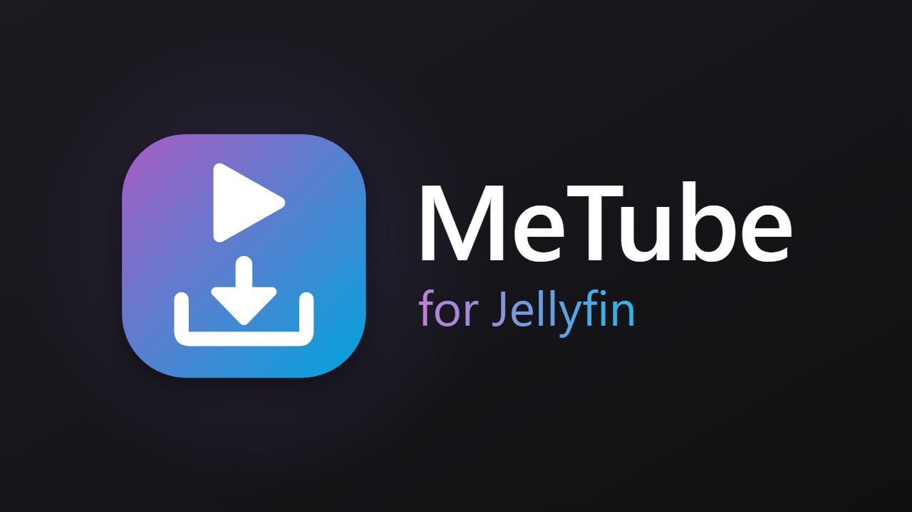
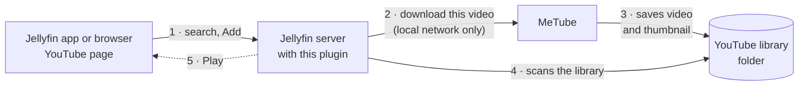

# MeTube for Jellyfin

<p align="center"></p>

Search YouTube inside Jellyfin, press **Add**, and watch the video from your own server, including when the internet is down.

The plugin adds a **YouTube** entry to Jellyfin's menu (web client and the Jellyfin Android app) for the users you choose. They search
YouTube or paste a link, and your [MeTube](https://github.com/alexta69/metube) server downloads the video straight into a Jellyfin library.
It shows up there with its title, thumbnail, description and date.

## How it works



1. On the **YouTube** page in Jellyfin you search and press **Add**. That goes to your own Jellyfin server, under your own Jellyfin login.
2. The plugin asks MeTube to download the video. Only the Jellyfin server talks to MeTube, over your local network, so MeTube never has to
   be reachable from the internet.
3. MeTube saves the video and its thumbnail in the folder of your YouTube library, one folder per channel:
   `youtube/<Channel>/<Title> [<video id>].mkv`.
4. The plugin has Jellyfin scan that library right away.
5. The button on the card turns into **Play**. The video is now in Jellyfin like any other, so it also plays when the internet is down.

## Features

- **A page inside Jellyfin.** YouTube opens at `#/youtube` under Jellyfin's own header and navigation, in the selected theme. Back, the
  Android back button and reloads work, and the address keeps the search, so you can bookmark it.
- **Search in Jellyfin.** Result cards show thumbnail, title, channel, length, views and age, with **Load more**. You can also paste any YouTube link.
- **Sort and filter.** Sort by newest (the default), relevance, popularity, shortest or longest. Filter by length (under 3 minutes, 3–20 minutes, over
  20 minutes) and upload date (today, this week, this month, this year).
- **One-click Add.** Each card tracks the download live: Add → Queued → Downloading 42% → Processing → **Play**.
- **Instant library update.** When MeTube finishes, the plugin scans just the YouTube library, so the video appears within seconds.
- **Delete.** Whoever added a video, and administrators, can delete it from the library and from disk. A confirmation comes first.
- **Merge channel folders.** Administrators can merge folders such as "Artist" and "ArtistVEVO" into one, from the YouTube page's
  Folders tab or from Jellyfin's own selection menu in the library ("Merge folders"). Later downloads from those channels follow
  automatically.
- **Tidy library.** Letterboxed 4:3 thumbnails are cropped to 16:9, so the library tile has no black bars, and the empty folders yt-dlp
  leaves in MeTube's temp folder are removed.
- **Who may add.** Administrators always can. You pick other users in the settings, and everyone else sees nothing.
- **Limits** for non-admins: the longest allowed video and videos per 24 hours. Live streams and premieres are always refused.
- **Added videos tab.** Users see their recent adds; admins see everyone's. Deleted videos drop off the list, and failed downloads can be
  cleared from it.
- **No YouTube API key.** Search uses YouTube's own web API. If YouTube changes its page layout, MeTube's yt-dlp search takes over.
- **MeTube stays private.** Browsers only talk to Jellyfin, and Jellyfin's server talks to MeTube over your LAN.

## Requirements

- Jellyfin **12.2** or newer.
- MeTube 2026.10 or newer, reachable from the Jellyfin server.
- MeTube's download folder (or a subfolder of it) mounted as a Jellyfin library. See [SETUP.md](SETUP.md).
- For Delete: Jellyfin needs write access to that folder.

## Install

1. Dashboard → Plugins → Repositories → **+**, URL:
   `https://raw.githubusercontent.com/SurfHost/jellyfin-plugin-metube/main/manifest.json`
2. Catalog → **MeTube** → Install, then restart Jellyfin.
3. Follow [SETUP.md](SETUP.md) for the MeTube settings (output folder, presets) and the Jellyfin library. Then open the plugin settings:
   enter the MeTube URL, pick the library, tick the users, and press **Test connection**.

## Security

- **Plugin endpoints.** Every endpoint requires a signed-in Jellyfin user, plus admin rights or a place on the allowed list. Only the
  client script (no secrets) is public.
- **Download URLs.** These are built server-side from a validated 11-character video ID, so nothing a user types reaches MeTube or yt-dlp.
- **Abuse limits.** Search is rate-limited per user and pauses automatically if YouTube starts throttling the server, so the NAS's
  address stays usable for downloads.
- **MeTube itself** has no login. Keep it off the internet; this plugin is what makes that possible.

## How the menu entry works

Jellyfin only shows plugin pages to administrators, inside the dashboard. To reach normal users, the plugin adds one `<script>` tag to
Jellyfin Web's `index.html` while it is served:

- The tag is added in memory only, never on disk.
- It works with read-only containers such as TrueNAS apps.
- It coexists with other plugins that inject scripts.

The script also gives the YouTube library's own links (header, side menu, home screen) the YouTube icon instead of the photo icon
Jellyfin uses for Home Videos libraries. That is CSS only, aimed at links to that one library.

If a future Jellyfin release breaks the entry, untick **Inject the YouTube menu entry** in the settings. Admins can still use
**Open YouTube search** there.

## Building

Requires the .NET 10 SDK.

```bash
dotnet build Jellyfin.Plugin.MeTube/Jellyfin.Plugin.MeTube.csproj -c Release
dotnet test Jellyfin.Plugin.MeTube.Tests/Jellyfin.Plugin.MeTube.Tests.csproj -c Release
```

Releases are built by GitHub Actions from a `vX.Y.Z` tag (see `.github/workflows/release.yml`).

## License

GPL-3.0. Not affiliated with YouTube, Google, Jellyfin or MeTube.
